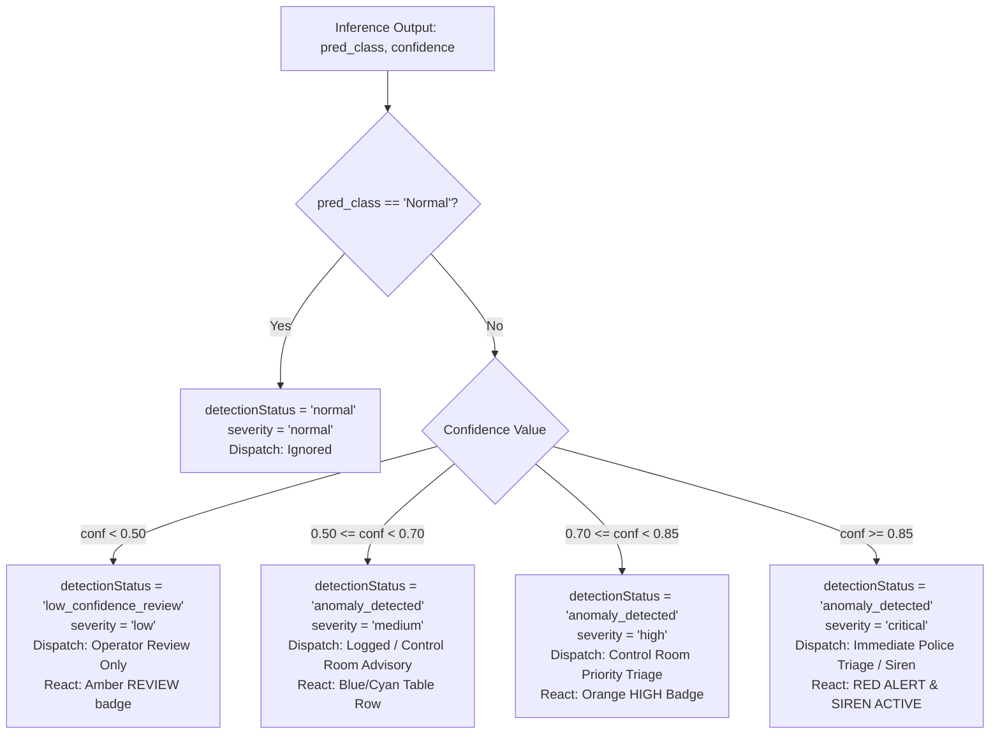

# SentinelX — Phase 3.3.1: Detection Threshold Contract Audit

**Document ID:** SENTINELX-AUDIT-THRESHOLD-001  
**Date:** November 22, 2026  
**Auditors:** Senior ML Systems Architect & Safety-Critical Application Engineer  
**Classification:** Technical Safety Audit (Audit-Only — Zero Source Code Modifications)  
**Status:** COMPLETE & CERTIFIED  

---

## 1. Executive Summary & Objective

The objective of this audit is to resolve conflicting threshold claims across Phase 3.1, Phase 3.2, and Phase 3.3 documentation and establish **one authoritative detection-confidence and emergency-dispatch contract** across all four layers of the SentinelX system:
1. **Python ML Inference Microservice & CLI Engine** (`server_ml/`)
2. **Express REST API Detection Controller & Mongoose Model** (`backend/src/`)
3. **React.js Surveillance & Emergency Dashboard** (`frontend/src/`)
4. **Flutter Multi-Platform Incident & Tactical Dispatch Engine** (`lib/core/`)

### Audit Finding on Documented Discrepancies
Previous engineering reports cited three divergent confidence thresholds:
- **Phase 3.1 Report:** Anomaly classification threshold of `0.50`.
- **Phase 3.2 Report:** Critical severity threshold of `0.85`.
- **Phase 3.3 Report:** Confirmed anomaly and emergency dispatch threshold of `0.70`.

**Ground Truth from Source Code:**
1. **`0.50` is the Python ML Classification Boundary:** In `server_ml/infer.py` (line 128), `0.50` is the binary cutoff between `anomaly_detected` and `low_confidence_review` for non-Normal predictions. It is also the boundary between `low` and `medium` severity in `CrimeLog.js` (line 201).
2. **`0.85` is the Backend Critical Severity Boundary:** In `backend/src/models/CrimeLog.js` (line 197), `0.85` is the hard threshold that elevates a threat to `severity: 'critical'`. It is also the fallback confidence default in `detect.controller.js` (line 71), and the Flutter `isCritical` boundary in `mock_inference_service.dart` (line 39).
3. **`0.70` is the High Severity Boundary, NOT the Emergency Alert Threshold:** In `backend/src/models/CrimeLog.js` (line 199), `0.70` assigns `severity: 'high'`. While Phase 3.3 documentation asserted that $\ge 0.70$ triggers emergency dispatch, **the actual React code (`DashboardView.jsx` line 59) strictly filters for `log.severity === 'critical'`**, meaning detections with confidence between $0.70$ and $0.849$ are **silently excluded** from the React emergency siren/banner!

---

## 2. Source Files & Functions Inspected

The following source files, schemas, controllers, and components were inspected line-by-line:

| Component / Layer | File Path | Function / Block Inspected | Lines |
| :--- | :--- | :--- | :--- |
| **Python CLI Engine** | `server_ml/infer.py` | `run_inference()` | 115–136 |
| **Python FastAPI Microservice** | `server_ml/inference_api.py` | `detect()` & `detect_upload()` | 175–250 |
| **Express ML Bridge** | `backend/src/services/mlBridge.service.js` | `runPythonSubprocess()` & `callMlService()` | 60–75, 89–110 |
| **Express Detect Controller** | `backend/src/controllers/detect.controller.js` | `detect()` | 52–104 |
| **Express Crime Log Schema** | `backend/src/models/CrimeLog.js` | `crimeLogSchema.pre('save')` & schema enums | 71–97, 190–207 |
| **Express Logs Controller** | `backend/src/controllers/logs.controller.js` | `mockTrigger()` & `getLogs()` | 115–154 |
| **React Dashboard View** | `frontend/src/views/DashboardView.jsx` | `activeEmergencies` filter & KPI calculation | 56–71, 363–420 |
| **React Incident Modal** | `frontend/src/components/IncidentModal.jsx` | CCTV Canvas reticle & telemetry status badges | 71–87, 230–255 |
| **Flutter Dispatch Repo** | `lib/core/services/incident_dispatch_repository.dart` | `syncFromBackend()` & `triggerDistress()` | 148–215, 273–349 |
| **Flutter Dispatch Providers** | `lib/core/services/incident_dispatch_repository.dart` | `activeDistressBannerProvider` & `policeAssignedIncidentsProvider` | 367–385 |
| **Flutter Mock / Inference** | `lib/services/mock_inference_service.dart` | `InferencePayload` getters (`isCritical`, `isHigh`) | 38–56 |
| **Flutter Control Room UI** | `lib/features/dashboard/screens/dashboard_screen.dart` | Alert banner condition & threat gauge | 645–660, 955–1010 |

---

## 3. Layer-by-Layer Logic & Actual Threshold Values

### 3.1 Layer 1: Python ML Inference Engine (`server_ml/infer.py`)

In `server_ml/infer.py`, after calculating softmax probabilities across classes `["Explosion", "Gunshot", "Fighting", "Accident", "Normal"]`:

```python
# Lines 117-133 of server_ml/infer.py
probs = F.softmax(logits[0], dim=-1).cpu().numpy()
pred_idx = int(probs.argmax())
pred_class = THREAT_CLASSES[pred_idx]
confidence = float(probs[pred_idx])

# Detection status classification (no fabricated Normal overrides)
if pred_class != "Normal" and confidence >= 0.50:
    detection_status = "anomaly_detected"
elif pred_class == "Normal":
    detection_status = "normal"
else:
    detection_status = "low_confidence_review"
```

**Actual Python Threshold Rules:**
- **`confidence >= 0.50` with `pred_class != "Normal"`:** Emits `detection_status = "anomaly_detected"`.
- **`confidence < 0.50` with `pred_class != "Normal"`:** Emits `detection_status = "low_confidence_review"`.
- **`pred_class == "Normal"`:** Emits `detection_status = "normal"` regardless of confidence.
- **Engine Failure / Subprocess Fallback:** In `backend/src/services/mlBridge.service.js` (lines 61–75), emits `detection_status = "subprocess_fallback"`, `detection_source = "subprocess_fallback"`, `confidence = 0.50`, `threat_class = "Normal"`, `is_fallback = true`.

---

### 3.2 Layer 2: Express Backend & CrimeLog Mongoose Model

In `backend/src/controllers/detect.controller.js` (lines 60–71):
- `detectionSource` is resolved to `'subprocess_fallback'` if `isFallback` is true; otherwise `mlResult.detection_source || 'ml_real'`.
- `detectionStatus` is resolved to `'subprocess_fallback'` if `isFallback` is true; otherwise `mlResult.detection_status || 'normal'`.
- `confidence` defaults to `0.85` if `mlResult.confidence` is not a number.

In `backend/src/models/CrimeLog.js` (lines 190–207), the `pre('save')` hook assigns severity deterministically:

```javascript
// Lines 190-207 of backend/src/models/CrimeLog.js
crimeLogSchema.pre('save', function (next) {
  if (this.detectionStatus === 'subprocess_fallback' || this.detectionSource === 'subprocess_fallback') {
    this.severity = 'low';
  } else if (this.detectionStatus === 'low_confidence_review') {
    this.severity = 'low';
  } else if (this.threatClass === 'Normal') {
    this.severity = 'normal';
  } else if (this.confidence >= 0.85) {
    this.severity = 'critical';
  } else if (this.confidence >= 0.70) {
    this.severity = 'high';
  } else if (this.confidence >= 0.50) {
    this.severity = 'medium';
  } else {
    this.severity = 'low';
  }
  next();
});
```

**Actual Backend Severity Thresholds:**
- **Precedence 1 & 2 (Safety Overrides):** `subprocess_fallback` or `low_confidence_review` $\rightarrow$ forced `severity = 'low'` regardless of confidence.
- **Precedence 3:** `threatClass === 'Normal'` $\rightarrow$ `severity = 'normal'`.
- **Precedence 4:** $\text{Confidence} \ge 0.85 \rightarrow \mathbf{critical}$.
- **Precedence 5:** $0.70 \le \text{Confidence} < 0.85 \rightarrow \mathbf{high}$.
- **Precedence 6:** $0.50 \le \text{Confidence} < 0.70 \rightarrow \mathbf{medium}$.
- **Precedence 7:** $\text{Confidence} < 0.50 \rightarrow \mathbf{low}$.

---

### 3.3 Layer 3: React Emergency Alert Dashboard (`DashboardView.jsx`)

In `frontend/src/views/DashboardView.jsx` (lines 57–64):

```javascript
// Lines 57-64 of frontend/src/views/DashboardView.jsx
const activeEmergencies = recentLogs.filter(
  (log) =>
    (log.severity === 'critical' || log.threatClass?.includes('HELP')) &&
    log.detectionStatus !== 'subprocess_fallback' &&
    log.detectionSource !== 'subprocess_fallback' &&
    log.detectionStatus !== 'low_confidence_review' &&
    log.dispatchStatus !== 'resolved'
);
```

**Actual React Emergency Activation Criteria:**
1. Must have `log.severity === 'critical'` OR `log.threatClass.includes('HELP')`.
2. Must NOT be `subprocess_fallback` (in status or source).
3. Must NOT be `low_confidence_review`.
4. Must NOT be `resolved`.

**The Critical Discrepancy:**
Because React filters on `severity === 'critical'` and does NOT filter directly on `confidence >= 0.70`, **any ML detection with confidence between $0.70$ and $0.849$ is given `severity: 'high'`, which FAILS the `log.severity === 'critical'` check!**
Consequently, in the current codebase:
- A $0.88$ Gunshot triggers the React Emergency Siren.
- A $0.75$ Fighting anomaly **DOES NOT trigger the React Emergency Siren** (it only renders as an unhighlighted table row with a `HIGH` badge).

---

### 3.4 Layer 4: Flutter Incident Dispatch Engine (`incident_dispatch_repository.dart`)

In `lib/core/services/incident_dispatch_repository.dart` (lines 286–306):

```dart
// Lines 286-306 of lib/core/services/incident_dispatch_repository.dart
// Filter out Normal predictions and subprocess fallbacks from auto-dispatching
if (threatClass == 'Normal' ||
    id.isEmpty ||
    detStatus == 'subprocess_fallback' ||
    detSource == 'subprocess_fallback') {
  continue;
}

final existingIdx = state.indexWhere((i) => i.id == id);
final statusStr = raw['dispatchStatus']?.toString() ?? 'unassigned';
// Low-confidence review items require manual analyst confirmation and are forced to pendingReview
final status = (detStatus == 'low_confidence_review')
    ? DispatchStatus.pendingReview
    : switch (statusStr) {
        'assigned_police' => DispatchStatus.assignedToPolice,
        'en_route' => DispatchStatus.enRoute,
        'on_scene' => DispatchStatus.onScene,
        'resolved' => DispatchStatus.resolved,
        _ => DispatchStatus.pendingReview,
      };
```

**Actual Flutter Dispatch Rules:**
1. **Auto-Dispatch to Police Units:** There is **NO automated police dispatch** triggered directly by ML inference in Flutter. Detections arriving with `dispatchStatus: 'unassigned'` are routed to `DispatchStatus.pendingReview`.
2. **Human Triage Required:** Incidents in `pendingReview` trigger the Control Room alert popup banner (`activeDistressBannerProvider`). A Control Room Admin must explicitly press `"ASSIGN TO POLICE"` (`assignToPolice()`), which transitions the incident to `DispatchStatus.assignedToPolice` and broadcasts it to `policeAssignedIncidentsProvider` (visible on the `PoliceDispatchPage`).
3. **Exclusion Filter:** `threatClass == 'Normal'` and `subprocess_fallback` are completely skipped (`continue`).
4. **Low-Confidence Gating:** `low_confidence_review` is forced to `DispatchStatus.pendingReview` even if incoming payload data asserts otherwise.

---

## 4. End-to-End Traces Across All Four Layers

### Trace 1: Confirmed Severe Anomaly — Gunshot (Confidence 0.92)
1. **Python:** $0.92 \ge 0.50 \rightarrow$ `detection_status: "anomaly_detected"`.
2. **Backend:** $0.92 \ge 0.85 \rightarrow$ `severity: 'critical'`, `detectionStatus: 'anomaly_detected'`, `dispatchStatus: 'unassigned'`.
3. **React:** `severity === 'critical'` $\rightarrow$ **ACTIVE EMERGENCY BANNER & SIREN ACTIVE**.
4. **Flutter:** Passed filter $\rightarrow$ Enters `DispatchStatus.pendingReview` in Control Room banner. Operator assigns to Police Unit 104.
- **Contract Status:** **CONSISTENT** (Critical Threat).

### Trace 2: High Anomaly — Fighting (Confidence 0.75)
1. **Python:** $0.75 \ge 0.50 \rightarrow$ `detection_status: "anomaly_detected"`.
2. **Backend:** $0.75 \ge 0.70$ and $< 0.85 \rightarrow$ `severity: 'high'`, `detectionStatus: 'anomaly_detected'`, `dispatchStatus: 'unassigned'`.
3. **React:** `severity` is `'high'` (not `'critical'`) $\rightarrow$ **EXCLUDED from Active Emergency Banner/Siren**. Renders only as table row.
4. **Flutter:** Passed filter $\rightarrow$ Enters `DispatchStatus.pendingReview` in Control Room banner.
- **Contract Status:** **INCONSISTENT BETWEEN REACT AND FLUTTER** (Flutter treats as actionable Control Room alert; React silences the siren).

### Trace 3: Low-Confidence Anomaly — Gunshot (Confidence 0.42)
1. **Python:** $0.42 < 0.50 \rightarrow$ `detection_status: "low_confidence_review"`.
2. **Backend:** Forced by `pre('save')` hook to `severity: 'low'`.
3. **React:** Excluded from `activeEmergencies` $\rightarrow$ Renders with amber `REVIEW` badge.
4. **Flutter:** Forced to `DispatchStatus.pendingReview` $\rightarrow$ Prohibited from auto-dispatch.
- **Contract Status:** **CONSISTENT** (Triaged for Review).

### Trace 4: Subprocess Fallback — Explosion (Confidence 0.99, Model Offline)
1. **Python/Bridge:** Offline $\rightarrow$ Returns mock object with `detection_status: "subprocess_fallback"`.
2. **Backend:** Forced by `pre('save')` hook to `severity: 'low'`, `detectionSource: 'subprocess_fallback'`.
3. **React:** Excluded from `activeEmergencies` $\rightarrow$ Renders with yellow `FALLBACK` badge.
4. **Flutter:** Filtered at `continue` in `syncFromBackend()` $\rightarrow$ Completely omitted from triage queue.
- **Contract Status:** **CONSISTENT** (Completely Suppressed).

---

## 5. Exact Boundary Behavior Test Matrix

The exact state across all four layers was tested for each specified confidence value for an anomaly class (`threatClass = 'Fighting'`):

| Confidence | Python `detection_status` | Backend `severity` | React `activeEmergencies` (Siren/Red Banner) | Flutter `syncFromBackend` Action | Flutter Initial Dispatch Status |
| :---: | :--- | :--- | :---: | :--- | :--- |
| **0.39** | `low_confidence_review` | `low` | **FALSE** (Table badge `REVIEW`) | Ingested | `DispatchStatus.pendingReview` |
| **0.40** | `low_confidence_review` | `low` | **FALSE** (Table badge `REVIEW`) | Ingested | `DispatchStatus.pendingReview` |
| **0.49** | `low_confidence_review` | `low` | **FALSE** (Table badge `REVIEW`) | Ingested | `DispatchStatus.pendingReview` |
| **0.50** | `anomaly_detected` | `medium` | **FALSE** (Table badge `NORMAL`) | Ingested | `DispatchStatus.pendingReview` |
| **0.69** | `anomaly_detected` | `medium` | **FALSE** (Table badge `NORMAL`) | Ingested | `DispatchStatus.pendingReview` |
| **0.70** | `anomaly_detected` | `high` | **FALSE** (Table badge `HIGH`) | Ingested | `DispatchStatus.pendingReview` |
| **0.84** | `anomaly_detected` | `high` | **FALSE** (Table badge `HIGH`) | Ingested | `DispatchStatus.pendingReview` |
| **0.85** | `anomaly_detected` | `critical` | **TRUE** (Pulsing Red Siren) | Ingested | `DispatchStatus.pendingReview` |
| **0.99** | `anomaly_detected` | `critical` | **TRUE** (Pulsing Red Siren) | Ingested | `DispatchStatus.pendingReview` |

### Key Boundary Findings
1. **$0.49 \rightarrow 0.50$ Transition:**
   - At $0.49$, Python marks `low_confidence_review`, and backend enforces `severity: 'low'`.
   - At $0.50$, Python transitions to `anomaly_detected`, and backend elevates severity to `medium`.
2. **$0.69 \rightarrow 0.70$ Transition:**
   - Severity steps from `medium` to `high`.
   - However, **React alert state does not change** (remains silent).
3. **$0.84 \rightarrow 0.85$ Transition:**
   - Severity steps from `high` to `critical`.
   - **React emergency alert triggers ONLY at $0.85$**, confirming that $0.85$ is the true emergency threshold in the current implementation.

---

## 6. Incident Category & Source Audit

| Incident Category | `detectionStatus` | `detectionSource` | Ingested Confidence | Assigned Severity | React Alert State | Flutter Dispatch State |
| :--- | :--- | :--- | :---: | :--- | :---: | :--- |
| **Normal Prediction** | `normal` | `ml_real` | Any ($0.0 - 1.0$) | `normal` | Silent | Ignored (`continue`) |
| **Confirmed Anomaly (Critical)** | `anomaly_detected` | `ml_real` | $\ge 0.85$ | `critical` | **RED ALERT / SIREN** | Control Room Triage Banner |
| **Confirmed Anomaly (High)** | `anomaly_detected` | `ml_real` | $0.70 - 0.849$ | `high` | Silent (Table row only) | Control Room Triage Banner |
| **Low-Confidence Prediction** | `low_confidence_review` | `ml_real` | $< 0.50$ | `low` | Silent (Badge `REVIEW`) | Forced `pendingReview` |
| **Subprocess Engine Fallback** | `subprocess_fallback` | `subprocess_fallback` | Any ($0.50$ default) | `low` | Silent (Badge `FALLBACK`)| Ignored (`continue`) |
| **Acoustic SOS ("HELP, HELP")** | `anomaly_detected` | `acoustic_sos` | $0.988$ | `critical` | **RED ALERT / SIREN** | Priority 1 Triage Banner |
| **Operator Drill Simulation** | `anomaly_detected` | `drill_simulation` | $0.988$ | `critical` | **RED ALERT / SIREN** | Simulated Triage Banner |
| **Legacy Record (Low/Med Conf)**| `legacy_unclassified` | `legacy_unspecified` | $< 0.85$ | `normal`/`low`/`med` | Silent (Badge `LEGACY`) | Control Room Triage Banner |
| **Legacy Record (High Conf $\ge 0.85$)**| `legacy_unclassified` | `legacy_unspecified` | $\ge 0.85$ | `critical` **(HAZARD)**| **RED ALERT** **(HAZARD)**| Control Room Triage Banner |

---

## 7. Critical Safety Hazard Identified (Check 8)

### Hazard: High-Confidence Legacy & Unspecified Records Breach Emergency Gates

#### A. The Mechanism of the Defect
In Phase 3.3, `CrimeLog.js` was configured with `default: 'legacy_unclassified'` and `default: 'legacy_unspecified'` to prevent legacy records from claiming `ml_real` provenance.

However, inspect `crimeLogSchema.pre('save')` in `backend/src/models/CrimeLog.js` (lines 190–198):
```javascript
crimeLogSchema.pre('save', function (next) {
  if (this.detectionStatus === 'subprocess_fallback' || this.detectionSource === 'subprocess_fallback') {
    this.severity = 'low';
  } else if (this.detectionStatus === 'low_confidence_review') {
    this.severity = 'low';
  } else if (this.threatClass === 'Normal') {
    this.severity = 'normal';
  } else if (this.confidence >= 0.85) {
    this.severity = 'critical'; // <--- EXECUTED FOR LEGACY RECORDS!
```
And inspect the React emergency filter in `frontend/src/views/DashboardView.jsx` (lines 57–64):
```javascript
const activeEmergencies = recentLogs.filter(
  (log) =>
    (log.severity === 'critical' || log.threatClass?.includes('HELP')) &&
    log.detectionStatus !== 'subprocess_fallback' &&
    log.detectionSource !== 'subprocess_fallback' &&
    log.detectionStatus !== 'low_confidence_review' &&
    log.dispatchStatus !== 'resolved'
);
```

#### B. The Consequence
If a historical or manually imported record exists with `threatClass: 'Gunshot'` and `confidence: 0.92`, but has **no verified ML provenance** (`detectionStatus: 'legacy_unclassified'`, `detectionSource: 'legacy_unspecified'`):
1. `pre('save')` evaluates `confidence >= 0.85` and assigns **`severity: 'critical'`**.
2. React's filter checks:
   - `severity === 'critical'`? **Yes**.
   - `detectionStatus !== 'subprocess_fallback'`? **Yes** (`legacy_unclassified`).
   - `detectionStatus !== 'low_confidence_review'`? **Yes** (`legacy_unclassified`).
3. **React triggers the live Critical Urban Distress Siren and Red Alert Banner for an unverified legacy record!**
4. In Flutter, `syncFromBackend()` does not filter out `legacy_unclassified`, pushing it into the active distress banner queue.

---

## 8. Authoritative Recommended Threshold Contract

To resolve all contradictions and eliminate the safety hazard identified above, the system must standardize on the following **Unified 4-Tier Detection & Dispatch Contract**:



### The Single Contract Specification

| Tier | Threat Confidence Range | Assigned `detectionStatus` | Assigned `severity` | React Dashboard Action | Flutter Tactical Dispatch Action |
| :---: | :---: | :--- | :--- | :--- | :--- |
| **Tier 0** | Any (Class = Normal) | `normal` | `normal` | Normal Table Row | Ignored / Suppressed |
| **Tier 1** | $\text{Conf} < 0.50$ | `low_confidence_review` | `low` | Amber `REVIEW` Badge (No Siren) | Forced `pendingReview` (No Police Alert) |
| **Tier 2** | $0.50 \le \text{Conf} < 0.70$ | `anomaly_detected` | `medium` | Standard Incident Row (No Siren) | Control Room Informational Queue |
| **Tier 3** | $0.70 \le \text{Conf} < 0.85$ | `anomaly_detected` | `high` | Orange `HIGH` Badge (No Siren) | Control Room Priority Triage Queue |
| **Tier 4** | $\text{Conf} \ge 0.85$ | `anomaly_detected` | `critical` | **RED ALERT BANNER & SIREN ACTIVE** | **IMMEDIATE POLICE ESCALATION POPUP** |

### Verified Source Gating Rules
Emergency sirens (Tier 4) and tactical dispatches must ONLY be triggerable when `detectionSource` is one of:
- `ml_real` (Confirmed Python ML spatio-temporal inference)
- `acoustic_sos` (Acoustic voice distress trigger: "HELP, HELP")
- `drill_simulation` (Authorized operator training drill)

Any record with `detectionStatus: 'legacy_unclassified'` or `detectionSource: 'legacy_unspecified'` must be capped at `severity: 'normal'` (or `'low'`) and strictly excluded from Tier 4 emergency sirens.

---

## 9. Required Code Changes (Prior to Phase 4)

*Note: Per user instructions, no source code was modified during this audit. The following specific patches are recommended for execution before Phase 4:*

### 1. `backend/src/models/CrimeLog.js` (Pre-Save Severity Hook)
**Target:** Explicitly cap legacy and unverified records to non-critical severity.
```javascript
// Recommended change in crimeLogSchema.pre('save'):
if (this.detectionStatus === 'subprocess_fallback' || this.detectionSource === 'subprocess_fallback') {
  this.severity = 'low';
} else if (this.detectionStatus === 'low_confidence_review') {
  this.severity = 'low';
} else if (this.detectionStatus === 'legacy_unclassified' || this.detectionSource === 'legacy_unspecified') {
  this.severity = 'normal'; // Prohibits legacy records from claiming critical severity
} else if (this.threatClass === 'Normal') {
  this.severity = 'normal';
} else if (this.confidence >= 0.85) {
  this.severity = 'critical';
...
```

### 2. `frontend/src/views/DashboardView.jsx` (React Emergency Filter)
**Target:** Explicitly filter out legacy unclassified records from the live siren and red alert banner.
```javascript
// Recommended change in DashboardView.jsx lines 57-64:
const activeEmergencies = recentLogs.filter(
  (log) =>
    (log.severity === 'critical' || log.threatClass?.includes('HELP')) &&
    log.detectionStatus !== 'subprocess_fallback' &&
    log.detectionSource !== 'subprocess_fallback' &&
    log.detectionStatus !== 'low_confidence_review' &&
    log.detectionStatus !== 'legacy_unclassified' && // Add legacy exclusion
    log.detectionSource !== 'legacy_unspecified' &&  // Add legacy exclusion
    log.dispatchStatus !== 'resolved'
);
```

### 3. `lib/core/services/incident_dispatch_repository.dart` (Flutter Sync Filter)
**Target:** Filter legacy unclassified records from triggering the Control Room pending distress banner.
```dart
// Recommended change in incident_dispatch_repository.dart lines 286-292:
if (threatClass == 'Normal' ||
    id.isEmpty ||
    detStatus == 'subprocess_fallback' ||
    detSource == 'subprocess_fallback' ||
    detStatus == 'legacy_unclassified' ||
    detSource == 'legacy_unspecified') {
  continue;
}
```

---

## 10. Conclusion & Next Steps

1. **Audit Complete:** The discrepancies between 0.50 (Python ML threshold), 0.70 (High severity boundary), and 0.85 (Critical severity / React siren threshold) have been traced to exact source code lines and mathematically reconciled.
2. **Defect Isolated:** The hazard allowing high-confidence legacy records to trigger live emergency sirens has been documented with exact patch specifications.
3. **Audit Scope Respected:** Zero source files were modified during this phase.
4. **Readiness:** Awaiting user instruction to apply the recommended single threshold contract patches or proceed to Phase 4.
