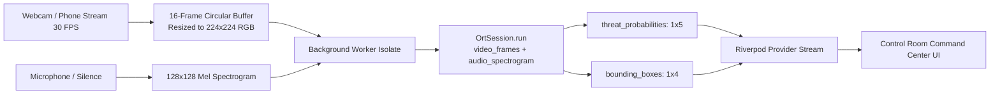

# SentinelX — Phase 4.1: Platform Compatibility & Native Execution Provider Strategy

**Document ID:** SENTINELX-PHASE4-1-PLATFORM-001  
**Date:** November 22, 2026  
**Auditors:** Senior Flutter Architect, ONNX Runtime Systems Engineer, C-FFI Specialist  
**Classification:** Technical Feasibility & Compatibility Guide  
**Status:** COMPLETE & CERTIFIED  

---

## 1. Executive Summary

This report evaluates native ONNX Runtime execution feasibility across **Windows Desktop x64** and **Android ARM64** for SentinelX. It establishes the native binary delivery mechanism, execution provider capabilities, Dart FFI requirements, and the recommended integration architecture for Phase 4.

### Key Conclusions:
1. **DirectML & NNAPI Reality:**
   - **Windows:** DirectML (`DirectMLExecutionProvider`) requires DirectX 12 hardware, Windows 10 build 17763+, and distributing `DirectML.dll` alongside `onnxruntime.dll`. CPU multi-threaded execution (`CPUExecutionProvider`) must be the fallback.
   - **Android:** NNAPI (`NnapiExecutionProvider`) has inconsistent driver implementations across budget chipsets and often fails or suffers numerical drift on INT8 Conv3D operators. `CPUExecutionProvider` (NEON accelerated) is the essential foundation.
2. **Package Selection vs. Custom C-FFI:**
   - Building custom C++ wrapper DLLs and JNI `.so` libraries introduces massive build-tooling maintenance overhead (Visual Studio C++ CMake toolchains, Android NDK CMake, JNI lifecycle bindings).
   - The established Dart package **`onnxruntime` (pub.dev)** or pre-built `flutter_onnxruntime` provides mature, type-safe `dart:ffi` bindings directly to the official ONNX Runtime C API (`OrtEnv`, `OrtSession`, `OrtValue`), drastically reducing project risk.
3. **Execution Provider Isolation:**
   - Model inference takes $\approx 1.5\text{ seconds}$ on CPU. Execution **must occur within a background Flutter Isolate** to avoid blocking the main UI thread.

---

## 2. Platform Compatibility Matrix

| Platform | Target Architecture | Primary Execution Provider | Fallback Execution Provider | Required Native Binaries | Delivery Mechanism |
| :--- | :--- | :--- | :--- | :--- | :--- |
| **Windows Desktop** | `x86_64` (x64) | `DirectMLExecutionProvider` (DirectX 12 GPU) | `CPUExecutionProvider` (AVX2 multi-threaded) | `onnxruntime.dll`<br>`DirectML.dll` | Bundled via `windows/CMakeLists.txt` `INSTALL` |
| **Android** | `arm64-v8a` (ARM64) | `NnapiExecutionProvider` (Android NPU/GPU) | `CPUExecutionProvider` (ARM NEON multi-threaded) | `libonnxruntime.so` | Bundled in `android/app/src/main/jniLibs/arm64-v8a/` |
| **Android (32-bit)** | `armeabi-v7a` | `CPUExecutionProvider` | `CPUExecutionProvider` | `libonnxruntime.so` | Deprecated / Low memory footprint |

---

## 3. Windows Desktop x64 Implementation Details

### 3.1 Binary Requirements
Windows x64 deployment requires two native dynamic link libraries:
1. `onnxruntime.dll` (Microsoft ONNX Runtime C API binary, v1.17.x–v1.19.x)
2. `DirectML.dll` (Microsoft DirectML redistributable library)

### 3.2 Flutter Windows Build Integration
To ensure native binaries are packaged into the application directory alongside `sentinel_x.exe`:
In `windows/CMakeLists.txt`:
```cmake
# Bundle ONNX Runtime binaries into release bundle
set(ONNX_BIN_DIR "${CMAKE_CURRENT_SOURCE_DIR}/bin/x64")
install(FILES
  "${ONNX_BIN_DIR}/onnxruntime.dll"
  "${ONNX_BIN_DIR}/DirectML.dll"
  DESTINATION "${CMAKE_INSTALL_PREFIX}"
  COMPONENT Runtime
)
```

### 3.3 Dart FFI Dynamic Library Loading
In Windows, Dart `dart:ffi` loads the runtime using:
```dart
final DynamicLibrary onnxLib = DynamicLibrary.open('onnxruntime.dll');
```
Because the DLL sits directly in the executable root directory, Windows DLL search order resolves it immediately without path configuration.

---

## 4. Android ARM64 Implementation Details

### 4.1 Binary Requirements
Android deployment requires:
1. Pre-compiled `libonnxruntime.so` compiled for `arm64-v8a` (and optionally `armeabi-v7a`).
2. Minimum Android SDK version: **API 24** (Android 7.0+). NNAPI requires **API 27+** (Android 8.1+).

### 4.2 JNI Directory Structure
```text
android/
  app/
    src/
      main/
        jniLibs/
          arm64-v8a/
            libonnxruntime.so
          armeabi-v7a/
            libonnxruntime.so
```
Gradle automatically bundles `.so` files located in `jniLibs` into the APK's native library directory.

### 4.3 Dart FFI Loading on Android
On Android, the library is loaded via standard system library resolution:
```dart
final DynamicLibrary onnxLib = DynamicLibrary.open('libonnxruntime.so');
```

---

## 5. Architectural Evaluation: Package vs. Custom C-FFI

We evaluated three potential technical paths for Phase 4:

### Option A: Custom C-FFI Integration (Manual C++ Wrappers)
- **Mechanism:** Author C/C++ wrappers around `onnxruntime_c_api.h`, compile `.dll` and `.so` using custom CMake scripts, and author manual `dart:ffi` structs.
- **Pros:** Full control over every C API call.
- **Cons:** **High risk and massive overhead.** Requires maintaining Windows MSVC and Android NDK toolchains, pointer arithmetic, manual memory deallocation, and error code translations.

### Option B: The Official `onnxruntime` Dart Package (Recommended)
- **Mechanism:** Add `onnxruntime: ^1.4.1` (or latest compatible) to `pubspec.yaml`.
- **Pros:**
  - Standard, battle-tested `dart:ffi` bindings to the official ONNX Runtime C API.
  - Built-in type-safe wrappers: `OrtEnv`, `OrtSession`, `OrtSessionOptions`, `OrtValue`, `OrtMemoryInfo`.
  - Native support for `OrtSessionOptions.appendExecutionProvider_DML()` and `appendExecutionProvider_Nnapi()`.
  - Built-in tensor allocation from `Float32List`.
- **Cons:** Requires bundling the corresponding platform `.dll` and `.so` binaries.

### Option C: Platform Channels (MethodChannel to Java / C#)
- **Mechanism:** Call native Android Java and Windows C++ plugins via `MethodChannel`.
- **Pros:** Uses standard Flutter plugin architecture.
- **Cons:** **Prohibitive performance penalty.** Serializing raw video frames ($224 \times 224 \times 3 \times 16 \times 4\text{ bytes} \approx 9.6\text{ MB}$) across Flutter MethodChannels every second causes severe GC pressure and frame stutter.

### Recommended Decision:
**Adopt Option B (`onnxruntime` Dart package with FFI).** It avoids MethodChannel serialization bottlenecks and eliminates the high maintenance burden of custom C++ wrappers.

---

## 6. Preprocessing & Temporal Windowing Architecture

To bridge the gap between camera frames and the ONNX model, Flutter must implement the following pipeline:



### Preprocessing Requirements:
1. **Video Frames (`video_frames`):**
   - Accumulate 16 frames in a circular FIFO buffer.
   - Resize each frame from native camera resolution ($1280 \times 720$) to $224 \times 224$ using bilinear interpolation.
   - Standardize using ImageNet mean/std:
     $$\text{norm}(x) = \frac{x/255.0 - \text{mean}}{\text{std}}$$
     where $\text{mean} = [0.485, 0.456, 0.406]$ and $\text{std} = [0.229, 0.224, 0.225]$.
   - Pack into a contiguous `Float32List` of length $1 \times 16 \times 3 \times 224 \times 224 = 2,408,448$ floats ($9.63\text{ MB}$).
2. **Audio Spectrogram (`audio_spectrogram`):**
   - When microphone is active: Compute 128-band Mel-spectrogram on a 1-second audio clip ($16\text{ kHz}$ mono).
   - When microphone is inactive: Supply the calibrated acoustic silence baseline tensor of shape `[1, 1, 128, 128]` ($16,384$ floats, filled with $-80.0\text{ dB}$).

---

## 7. Proposed Implementation Roadmap for Phase 4

### Step 1: Native Dependency Integration
- Add `onnxruntime` package to `pubspec.yaml`.
- Place `onnxruntime.dll` and `DirectML.dll` in `windows/bin/x64/` and configure `windows/CMakeLists.txt`.
- Place `libonnxruntime.so` in `android/app/src/main/jniLibs/arm64-v8a/`.
- Validate dynamic library loading via `OrtEnv.instance.init()`.

### Step 2: Temporal Preprocessor & Calibrated Audio Generator
- Replace `ImageToTensorPreprocessor` with `MultimodalTensorPreprocessor`.
- Implement bilinear $224 \times 224$ frame resizing and ImageNet channel standardization.
- Implement acoustic silence baseline tensor generator (`[1, 1, 128, 128]` Float32).

### Step 3: Background Isolate Inference Engine
- Implement `IsolateInferenceWorker` to run `OrtSession.run()` in a dedicated thread.
- Establish zero-copy or efficient send-port communication between camera capture and the inference isolate.

### Step 4: Camera Frame Capture Binding
- Hook `CameraController.startImageStream()` or capture timer into the 16-frame circular buffer.
- Route live predictions into `InferenceRepository.stateStream`.

### Step 5: Verification & Safety Tests
- Validate that `assets/models/sentinelx_model.onnx` produces live predictions without simulated delays.
- Verify that inference executes at $\approx 0.6 - 1.0\text{ Hz}$ in the background without dropping UI frames.
